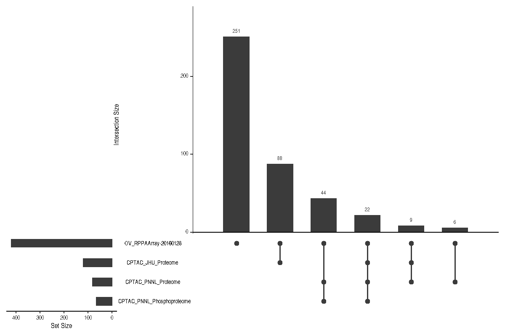

# CPTACdata

# Overview

The Clinical Proteomic Tumor Analysis Consortium (CPTAC) profiled the
proteomes of several hundred TCGA tumors. `CPTACdata` downloads those
data from the Proteomic Data Commons (PDC) and appends them to a
`MultiAssayExperiment` from `curatedTCGAData`. It also downloads the
CPTAC cohorts that use their own patients; see [CPTAC cohorts beyond
TCGA](#cptac-cohorts-beyond-tcga).

TCGA measured the genome and transcriptome of these tumors, and only a
small panel of proteins with antibody arrays. Mass-spectrometry
proteomics measures the protein layer directly, and protein levels often
differ from mRNA levels, so matched protein data lets you compare the
layers in the same patients. Adding the CPTAC data to a
`MultiAssayExperiment` you already use keeps the samples aligned across
all assays.

`cBioPortalData` also returns cancer study data as
`MultiAssayExperiment` objects, and it includes TCGA reverse-phase
protein array (RPPA) data. `CPTACdata` reads the mass-spectrometry
quantifications directly from the PDC for the CPTAC-TCGA cohorts. Check
whether the cBioPortal studies you need contain the same CPTAC data
before choosing between the two.

``` r
library(CPTACdata)
library(curatedTCGAData)
library(MultiAssayExperiment)
```

# Installation

``` r
if (!requireNamespace("BiocManager", quietly = TRUE))
    install.packages("BiocManager")

BiocManager::install("CPTACdata")
```

# CPTAC cohorts beyond TCGA

This vignette covers CPTAC data generated on TCGA tumors. Most CPTAC
data come from cohorts with their own patients instead: the CPTAC-3
discovery and confirmatory cohorts, such as clear cell renal cell
carcinoma, glioblastoma and lung adenocarcinoma, and the CPTAC-2
Prospective collections. `getCPTAC()` downloads one of these cohorts as
a new `MultiAssayExperiment`, with one experiment per PDC study and the
PDC clinical data of its patients. The cohorts are listed in
`cptacCohorts`.

The vignette “Downloading CPTAC cohorts as MultiAssayExperiment objects”
walks through an example:

``` r
vignette("CPTACcohorts", package = "CPTACdata")
```

# Which TCGA projects have CPTAC data?

`cptacProjects` has one row per TCGA project and PDC study. Its columns
are:

- `tcga_project`: the TCGA project the study covers.
- `pdc_study_id`: the PDC study identifier.
- `pdc_name`: the PDC study name.
- `experiment`: the name given to the experiment added to the object.
- `analytical_fraction`: Proteome, Phosphoproteome or Glycoproteome.
- `data_type`: the PDC quantification matrix that is downloaded, or
  `NA`.
- `pdc_disease_type`: a PDC label used to split a study that covers more
  than one TCGA project, or `NA`.
- `verified`: `TRUE` if every qualified TCGA patient in the study was
  found in the GDC project when the data were built.

Some rows have `data_type = NA`. For these studies the PDC holds
biospecimen records, but its API returns no quantification matrix for
any data type tried. `appendCPTAC()` skips them with a warning, so they
never add an experiment.

``` r
data("cptacProjects", package = "CPTACdata")
cptacProjects
#>   tcga_project pdc_study_id                                          pdc_name
#> 1    TCGA-BRCA    PDC000173                       TCGA Breast Cancer Proteome
#> 2    TCGA-BRCA    PDC000174                TCGA Breast Cancer Phosphoproteome
#> 3    TCGA-COAD    PDC000111                        TCGA Colon Cancer Proteome
#> 4    TCGA-READ    PDC000111                        TCGA Colon Cancer Proteome
#> 5      TCGA-OV    PDC000112                    TCGA Ovarian JHU Glycoproteome
#> 6      TCGA-OV    PDC000113                         TCGA Ovarian JHU Proteome
#> 7      TCGA-OV    PDC000114                        TCGA Ovarian PNNL Proteome
#> 8      TCGA-OV    PDC000115 TCGA Ovarian PNNL Phosphoproteome Velos Qexactive
#>                   experiment analytical_fraction  data_type
#> 1             CPTAC_Proteome            Proteome log2_ratio
#> 2      CPTAC_Phosphoproteome     Phosphoproteome log2_ratio
#> 3             CPTAC_Proteome            Proteome       <NA>
#> 4             CPTAC_Proteome            Proteome       <NA>
#> 5    CPTAC_JHU_Glycoproteome       Glycoproteome       <NA>
#> 6         CPTAC_JHU_Proteome            Proteome log2_ratio
#> 7        CPTAC_PNNL_Proteome            Proteome log2_ratio
#> 8 CPTAC_PNNL_Phosphoproteome     Phosphoproteome log2_ratio
#>        pdc_disease_type verified
#> 1                  <NA>     TRUE
#> 2                  <NA>     TRUE
#> 3  Colon Adenocarcinoma     TRUE
#> 4 Rectum Adenocarcinoma     TRUE
#> 5                  <NA>     TRUE
#> 6                  <NA>     TRUE
#> 7                  <NA>     TRUE
#> 8                  <NA>     TRUE
```

# Appending to a MultiAssayExperiment

Start with any `curatedTCGAData` object for one TCGA project. Only
patients in its `colData` can be matched, so include enough assays to
cover the patients of interest.

Downloading the TCGA object, the dry run and the append all need network
access. The dry run and the append query the PDC API at
`https://pdc.cancer.gov/graphql`. `cptacProjects` ships with the package
and needs no network access. Biospecimen tables are cached for the R
session, so a dry run followed by an append downloads each one only
once.

The CPTAC data are provided under the PDC Data Use Agreement at
<https://proteomic.datacommons.cancer.gov/pdc/data-use-guidelines>. Read
it before running the next chunk, which accepts it on your behalf for
this document:

``` r
options(CPTACdata.acceptDUA = TRUE)
```

``` r
mae <- curatedTCGAData("OV", "RPPAArray", version = "2.1.1", dry.run = FALSE)
```

A dry run reports how many patients each PDC study shares with the
object, downloading only sample metadata:

``` r
appendCPTAC(mae, dry_run = TRUE)
#>            experiment pdc_study_id quant_available mae_patients pdc_patients
#> 1  CPTAC_JHU_Proteome    PDC000113            TRUE          420          122
#> 2 CPTAC_PNNL_Proteome    PDC000114            TRUE          420           84
#>   matched_patients
#> 1              119
#> 2               81
```

The dry run returns one row per study for the requested project and
fraction. Its columns are:

- `experiment`: the name the study would be added as.
- `pdc_study_id`: the PDC study identifier.
- `quant_available`: `TRUE` if the PDC has a quantification matrix for
  the study.
- `mae_patients`: the number of patients in the object.
- `pdc_patients`: the number of TCGA patients in the study that pass the
  specimen filters.
- `matched_patients`: the number of those patients that are also in the
  object.

Studies without a matrix show `NA` for `pdc_patients` and
`matched_patients`.

Then add the data. The project is detected from `colData`, and the
**proteome is added by default**. Call `appendCPTAC()` again for other
assay types:

``` r
mae <- appendCPTAC(mae)
#> Adding CPTAC_JHU_Proteome from PDC000113 (119 patients)...
#> Adding CPTAC_PNNL_Proteome from PDC000114 (81 patients)...
mae <- appendCPTAC(mae, fraction = "Phosphoproteome")
#> Adding CPTAC_PNNL_Phosphoproteome from PDC000115 (66 patients)...
mae
#> A MultiAssayExperiment object of 4 listed
#>  experiments with user-defined names and respective classes.
#>  Containing an ExperimentList class object of length 4:
#>  [1] OV_RPPAArray-20160128: SummarizedExperiment with 208 rows and 427 columns
#>  [2] CPTAC_JHU_Proteome: SummarizedExperiment with 8597 rows and 119 columns
#>  [3] CPTAC_PNNL_Proteome: SummarizedExperiment with 7480 rows and 81 columns
#>  [4] CPTAC_PNNL_Phosphoproteome: SummarizedExperiment with 21478 rows and 66 columns
#> Functionality:
#>  experiments() - obtain the ExperimentList instance
#>  colData() - the primary/phenotype DataFrame
#>  sampleMap() - the sample coordination DataFrame
#>  `$`, `[`, `[[` - extract colData columns, subset, or experiment
#>  *Format() - convert into a long or wide DataFrame
#>  assays() - convert ExperimentList to a SimpleList of matrices
#>  exportClass() - save data to flat files
```

The new experiments have one column per TCGA sample, and the `sampleMap`
links them to patients:

``` r
tail(sampleMap(mae))
#> DataFrame with 6 rows and 3 columns
#>                             assay      primary                colname
#>                          <factor>  <character>            <character>
#> [688,] CPTAC_PNNL_Phosphoproteome TCGA-61-1907 TCGA-61-1907-01A-32-..
#> [689,] CPTAC_PNNL_Phosphoproteome TCGA-61-1919 TCGA-61-1919-01A-31-..
#> [690,] CPTAC_PNNL_Phosphoproteome TCGA-61-1995 TCGA-61-1995-01A-32-..
#> [691,] CPTAC_PNNL_Phosphoproteome TCGA-61-2008 TCGA-61-2008-01A-42-..
#> [692,] CPTAC_PNNL_Phosphoproteome TCGA-61-2095 TCGA-61-2095-01A-31-..
#> [693,] CPTAC_PNNL_Phosphoproteome TCGA-61-2612 TCGA-61-2612-01A-31-..
mae[["CPTAC_PNNL_Proteome"]]
#> class: SummarizedExperiment 
#> dim: 7480 81 
#> metadata(8): pdc_study_id pdc_name ... retrieved CPTACdata_version
#> assays(1): log2_ratio
#> rownames(7480): A1BG A2M ... ZYX ZZEF1
#> rowData names(0):
#> colnames(81): TCGA-09-1664-01A TCGA-13-1484-01A ... TCGA-61-2096-01A
#>   TCGA-61-2612-01A
#> colData names(5): case_submitter_id sample_submitter_id
#>   aliquot_submitter_id sample_type pdc_column
```

Each new experiment is a `SummarizedExperiment` with one assay, named
after its `data_type`. For the proteome and phosphoproteome the assay is
`log2_ratio`. Each value is the log2 ratio of a sample’s abundance to a
common reference that the PDC used for the whole study. A value of 0
means the same abundance as the reference, 1 means twice the reference,
and -1 means half. The reference is set per study, so compare values
across experiments with care.

Each experiment also records where its data came from, in its metadata.
This includes the PDC study version and the time the matrix was
downloaded:

``` r
S4Vectors::metadata(mae[["CPTAC_PNNL_Proteome"]])
#> $pdc_study_id
#> [1] "PDC000114"
#> 
#> $pdc_name
#> [1] "TCGA Ovarian PNNL Proteome"
#> 
#> $data_type
#> [1] "log2_ratio"
#> 
#> $source
#> [1] "https://pdc.cancer.gov/graphql"
#> 
#> $pdc_study_version
#> [1] "1"
#> 
#> $pdc_study_uuid
#> [1] "baa8ae46-57b8-11e8-b07a-00a098d917f8"
#> 
#> $retrieved
#> [1] "2026-11-12 16:08:36 EST"
#> 
#> $CPTACdata_version
#> [1] "0.99.7"
```

Rows are genes in the proteome. In the phosphoproteome they are RefSeq
protein and site identifiers, such as `NP_000005.2:s710`. Columns keep
the labels of the PDC matrix, with `TCGA-` added where the PDC leaves it
out: sample barcodes in the proteome and aliquot barcodes in the
phosphoproteome. Missing values are stored as `NA`.

Technical replicates of a sample carry a `.1`, `.2` suffix in the PDC
matrix. All replicates are kept, and the suffix stays in the column
name, such as `TCGA-C8-A131-01A.1` and `TCGA-C8-A131-01A.2`. The
`sample_submitter_id` column of `colData` gives the sample barcode
shared by the replicates. Use `replicates = "first"` to keep only the
first replicate of each sample. Patients who are in the object but
missing from the PDC matrix get no column, and the append reports how
many there are.

The JHU and PNNL ovarian proteomes are separate experiments that share
some patients:

``` r
upsetSamples(mae)
```



# Session info

``` r
sessionInfo()
#> R version 4.6.1 Patched (2026-07-12 r90246)
#> Platform: x86_64-pc-linux-gnu
#> Running under: Ubuntu 26.04.1 LTS
#> 
#> Matrix products: default
#> BLAS:   /usr/lib/x86_64-linux-gnu/blas/libblas.so.3.12.1 
#> LAPACK: /home/mramos/src/svn/r-4-6/inst/lib/R/lib/libRlapack.so;  LAPACK version 3.12.1
#> 
#> locale:
#>  [1] LC_CTYPE=en_US.UTF-8       LC_NUMERIC=C              
#>  [3] LC_TIME=en_US.UTF-8        LC_COLLATE=en_US.UTF-8    
#>  [5] LC_MONETARY=en_US.UTF-8    LC_MESSAGES=en_US.UTF-8   
#>  [7] LC_PAPER=en_US.UTF-8       LC_NAME=C                 
#>  [9] LC_ADDRESS=C               LC_TELEPHONE=C            
#> [11] LC_MEASUREMENT=en_US.UTF-8 LC_IDENTIFICATION=C       
#> 
#> time zone: America/New_York
#> tzcode source: system (glibc)
#> 
#> attached base packages:
#> [1] stats4    stats     graphics  grDevices utils     datasets  methods  
#> [8] base     
#> 
#> other attached packages:
#>  [1] curatedTCGAData_1.35.1      MultiAssayExperiment_1.39.1
#>  [3] SummarizedExperiment_1.43.0 Biobase_2.73.2             
#>  [5] GenomicRanges_1.65.4        Seqinfo_1.3.2              
#>  [7] IRanges_2.47.5              S4Vectors_0.51.10          
#>  [9] BiocGenerics_0.59.12        generics_0.1.4             
#> [11] MatrixGenerics_1.25.0       matrixStats_1.5.0          
#> [13] CPTACdata_0.99.7           
#> 
#> loaded via a namespace (and not attached):
#>  [1] tidyselect_1.2.1          dplyr_1.2.1              
#>  [3] blob_1.3.0                filelock_1.0.3           
#>  [5] Biostrings_2.81.9         bitops_1.1-0             
#>  [7] fastmap_1.2.0             RCurl_1.98-1.20          
#>  [9] BiocFileCache_3.3.2       GenomicAlignments_1.49.2 
#> [11] XML_3.99-0.25             digest_0.6.39            
#> [13] lifecycle_1.0.5           KEGGREST_1.53.6          
#> [15] RSQLite_3.53.3            magrittr_2.0.5           
#> [17] compiler_4.6.1            rlang_1.3.0              
#> [19] tools_4.6.1               yaml_2.3.12              
#> [21] rtracklayer_1.73.0        knitr_1.52               
#> [23] S4Arrays_1.13.2           bit_4.6.0                
#> [25] curl_8.1.0                DelayedArray_0.39.8      
#> [27] xml2_1.6.0                BiocParallel_1.47.0      
#> [29] abind_1.4-8               withr_3.0.3              
#> [31] purrr_1.2.2               grid_4.6.1               
#> [33] ExperimentHub_3.3.2       cli_3.6.6                
#> [35] rmarkdown_2.32            crayon_1.5.3             
#> [37] otel_0.3.0                rstudioapi_0.19.0        
#> [39] httr_1.4.9                tzdb_0.5.0               
#> [41] rjson_0.2.23              BiocBaseUtils_1.15.1     
#> [43] GenomicDataCommons_1.37.0 DBI_1.3.0                
#> [45] cachem_1.1.0              stringr_1.6.0            
#> [47] rvest_1.0.5               parallel_4.6.1           
#> [49] AnnotationDbi_1.75.2      BiocManager_1.30.27      
#> [51] XVector_0.53.0            restfulr_0.0.17          
#> [53] vctrs_0.7.3               Matrix_1.7-6             
#> [55] jsonlite_2.0.0            hms_1.1.4                
#> [57] bit64_4.8.6               GenomicFeatures_1.65.0   
#> [59] glue_1.8.1                codetools_0.2-20         
#> [61] stringi_1.8.9             BiocVersion_3.24.0       
#> [63] GenomeInfoDb_1.49.1       BiocIO_1.23.3            
#> [65] UCSC.utils_1.9.0          tibble_3.3.1             
#> [67] pillar_1.11.1             rappdirs_0.3.4           
#> [69] htmltools_0.5.9           R6_2.6.1                 
#> [71] dbplyr_2.6.0              httr2_1.3.0              
#> [73] evaluate_1.0.5            lattice_0.23-1           
#> [75] readr_2.2.0               AnnotationHub_4.3.3      
#> [77] cigarillo_1.3.1           Rsamtools_2.29.0         
#> [79] png_0.1-9                 memoise_2.0.1            
#> [81] SparseArray_1.13.4        xfun_0.62                
#> [83] TCGAutils_1.33.3          pkgconfig_2.0.3
```
